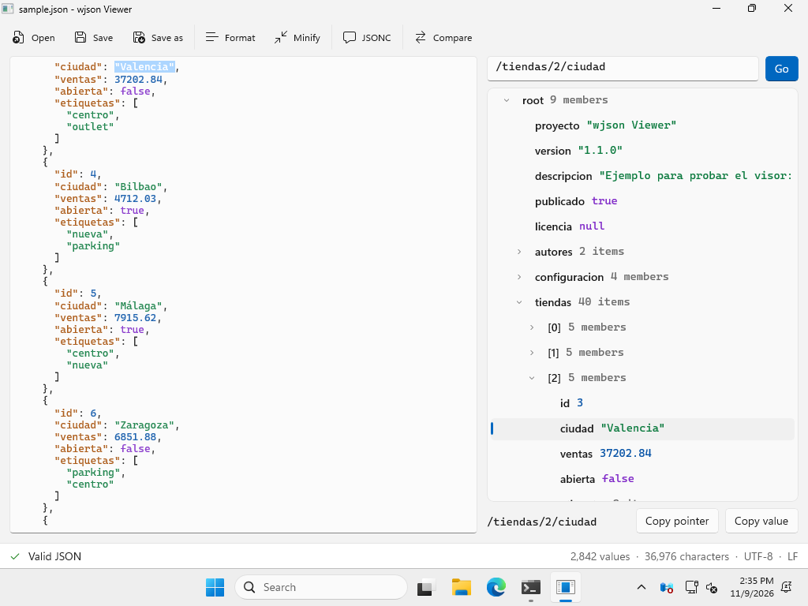

# win-json-parser

[](https://github.com/imontene/win-json-parser/actions/workflows/ci.yml)

Parser de JSON rápido, robusto y conforme a estándares, escrito en C++17 y diseñado para Windows.

> Versión [1.2.0](https://github.com/imontene/win-json-parser/releases/latest). Las APIs de C++ y C siguen [versionado semántico](CHANGELOG.md).

## Características

- Parser estricto conforme a **RFC 8259**: pasa todos los casos `y_` y `n_` de [JSONTestSuite](https://github.com/nst/JSONTestSuite).
- **Árbol (DOM)** para trabajar cómodamente con el documento, o **streaming (SAX)** para procesar archivos de cualquier tamaño con memoria constante.
- Errores con **línea, columna y fragmento** del texto donde falla.
- **UTF-8 validado** y lectura de archivos **UTF-8 con o sin BOM y UTF-16 LE/BE** (los que generan el Bloc de notas o PowerShell), también en streaming.
- **JSONC** opcional, con comentarios y comas finales como en los ajustes de VS Code y Windows Terminal.
- Consultas **JSON Pointer** (RFC 6901), por ejemplo `/usuarios/0/nombre`.
- **Límites de seguridad** configurables (profundidad, longitud de strings y tamaño del documento) frente a entradas maliciosas.
- Serialización compacta o formateada, con opción de escapar todo lo que no sea ASCII.
- Herramienta de línea de comandos `wjson.exe` en un único ejecutable, sin dependencias.
- Disponible desde **C++**, **C** (ABI estable, `wjson.dll`), **.NET** (NuGet) y **PowerShell** (módulo `Wjson`).
- **wjson Viewer**: aplicación de escritorio para Windows con editor, árbol y validación en vivo.
- Probado con JSONTestSuite, sanitizers y **fuzzing continuo**.

Consulta la hoja de ruta en [docs/FEATURES.md](docs/FEATURES.md), el diseño en [docs/ARCHITECTURE.md](docs/ARCHITECTURE.md) y el rendimiento en [docs/BENCHMARKS.md](docs/BENCHMARKS.md).

## wjson Viewer



Aplicación de escritorio para Windows 10 y 11 (WinUI 3):

- **Editor** con validación mientras escribes. Los errores indican línea y columna, y el enlace **Ir al error** lleva a la posición exacta.
- **Árbol** del documento con valores coloreados por tipo. Los arrays grandes se dividen en rangos de 1000 elementos.
- **Búsqueda con JSON Pointer**: escribe `/tiendas/2/ciudad` y se expande el árbol hasta ese valor. Puedes copiar el puntero o el valor de cualquier nodo.
- **Formatear**, **minificar** y modo **JSONC**, que se activa solo con los archivos `.jsonc`.
- Conserva la codificación (UTF-8, UTF-8 con BOM, UTF-16) y los finales de línea al guardar.
- Los archivos de más de 8 MB se abren en solo lectura y se validan en streaming.
- Abrir, guardar y arrastrar archivos. Interfaz en español o inglés, según Windows.

No necesita instalación: descarga `wjson-viewer-<versión>-windows-<arquitectura>.zip` de la [última release](https://github.com/imontene/win-json-parser/releases/latest), descomprímelo y ejecuta `WjsonViewer.exe`. Desde la línea de comandos:

```powershell
WjsonViewer.exe datos.json --pointer /usuarios/0 --lang es
```

## Uso de la CLI

```text
wjson validate config.json otro.json       # 0 = válido, 1 = inválido (streaming)
wjson format --indent 4 data.json          # formatear
wjson minify data.json > data.min.json     # compactar
wjson query /items/0/name data.json        # extraer un valor (JSON Pointer)
wjson query --raw /version package.json    # string sin comillas
wjson validate --jsonc settings.json       # aceptar comentarios y comas finales
type data.json | wjson format              # leer desde stdin
```

Códigos de salida: `0` correcto, `1` JSON inválido, `2` error de uso o de E/S, `3` el puntero de `query` no existe.

Ejemplo de error:

```text
config.json:3:14: error: unexpected character
    "b": [1, 2,]
               ^
```

> **Git Bash / MSYS2:** estos shells convierten los argumentos que empiezan por `/` en rutas de Windows. Para `query`, usa `MSYS_NO_PATHCONV=1 wjson query /items/0 data.json`. PowerShell y `cmd` no tienen este problema.

## Uso de la biblioteca

### Árbol (DOM)

```cpp
#include <wjson/wjson.hpp>

auto result = wjson::parse_file(L"C:\\datos\\config.json");
if (!result) {
    const auto& e = result.error;
    std::printf("Error en %zu:%zu: %s\n", e.line, e.column, e.message());
    return;
}
const wjson::Value& doc = *result.value;

if (const wjson::Value* name = doc.find("nombre"))
    std::puts(name->as_string().c_str());

if (const wjson::Value* city = doc.at_pointer("/usuarios/0/direccion/ciudad"))
    std::puts(city->as_string().c_str());

std::string pretty = wjson::serialize(doc, {/*indent=*/2});
```

### Streaming (SAX)

Para archivos muy grandes, hereda de `wjson::Handler` y recibe los eventos sin construir el árbol. Devolver `false` en cualquier callback cancela el parseo.

```cpp
struct Counter : wjson::Handler {
    std::size_t objects = 0;
    bool on_start_object() override { ++objects; return true; }
};

Counter counter;
wjson::ParseError error = wjson::parse_file(L"C:\\logs\\eventos.json", counter);
if (error.ok()) std::printf("%zu objetos\n", counter.objects);
```

Un `wjson::Handler` sin modificar sirve como validador. También están `wjson::parse_stream(std::istream&, ...)` y `wjson::parse(texto, handler)`.

### API en C

Para C o para crear bindings desde otros lenguajes, `wjson/wjson.h` ofrece una ABI estable sin excepciones:

```c
#include <wjson/wjson.h>

wjson_error error;
wjson_document* doc = wjson_parse(text, WJSON_NUL_TERMINATED, NULL, &error);
if (!doc) {
    printf("%zu:%zu: %s\n", error.line, error.column, wjson_error_message(error.code));
    return 1;
}
const wjson_value* name = wjson_value_at_pointer(wjson_document_root(doc), "/usuario/nombre", WJSON_NUL_TERMINATED);
printf("%s\n", wjson_value_get_string(name, NULL));
wjson_document_free(doc);
```

### Opciones

```cpp
wjson::ParseOptions options = wjson::ParseOptions::jsonc();  // comentarios + comas finales
options.max_depth = 64;
options.max_string_length = 1 << 20;        // 1 MiB por string
options.max_document_size = 100 << 20;      // 100 MiB por documento
auto result = wjson::parse(texto, options);
```

## .NET

```csharp
using Wjson;

var settings = (JsonObject)WJson.ParseFile("settings.json", ParseOptions.Jsonc)!;
Console.WriteLine(settings["editor.fontSize"]);

if (!WJson.TryValidateFile("enorme.json", out var error))
    Console.WriteLine($"{error!.Line}:{error.Column}: {error.Message}");

string bonito = WJson.Format("{\"a\":[1,2]}", indent: 4);
```

Paquete NuGet `Imontene.Wjson` (`netstandard2.0` y `net8.0`), con binarios nativos para win-x64, win-x86, win-arm64 y linux-x64.

## PowerShell

```powershell
Import-Module Wjson

Test-WJson -Path .\config.json -Detailed          # Valid, Line, Column, Message...
$s = ConvertFrom-WJson -Path "$env:APPDATA\Code\User\settings.json" -Jsonc
Get-Content data.json -Raw | Format-WJson -Indent 4
Get-WJsonValue /dependencies/0/name -Path .\package.json
```

Funciona en Windows PowerShell 5.1 y en PowerShell 7. A diferencia de `ConvertFrom-Json`, indica la línea y la columna de cada error, acepta JSONC, lee archivos UTF-16 y valida archivos de cualquier tamaño en streaming.

## Instalación

```powershell
Install-Module Wjson                       # PowerShell (PowerShell Gallery)
dotnet add package Imontene.Wjson          # .NET (NuGet)
```

El CLI `wjson.exe` y wjson Viewer se descargan desde la [última release](https://github.com/imontene/win-json-parser/releases/latest) (x64, x86 y ARM64). La instalación con `winget install imontene.wjson` estará disponible cuando se acepten sus manifiestos en winget-pkgs.

### vcpkg

El repositorio incluye un port *overlay* (todavía no está en el registro oficial):

```powershell
vcpkg install wjson[tool] --overlay-ports=C:\ruta\a\win-json-parser\ports
```

### CMake

```cmake
# Como subproyecto
add_subdirectory(win-json-parser)
target_link_libraries(mi_app PRIVATE wjson::wjson)

# O tras instalarlo (cmake --install), o con vcpkg
find_package(wjson CONFIG REQUIRED)
target_link_libraries(mi_app PRIVATE wjson::wjson)
```

## Compilar

Requisitos: CMake ≥ 3.21 y uno de estos compiladores: Visual Studio 2022 o posterior (MSVC o clang-cl), MinGW-w64 GCC ≥ 11, o GCC/Clang en Linux.

```powershell
cmake --preset msvc-x64
cmake --build build/msvc-x64 --config Release
ctest --test-dir build/msvc-x64 -C Release --output-on-failure
```

Otros presets: `msvc-x86`, `msvc-arm64`, `clang-cl-x64`, `linux-gcc` y `linux-clang-sanitize`. Añade `-DBUILD_SHARED_LIBS=ON` para compilar `wjson.dll`. También puedes abrir la carpeta directamente con Visual Studio, que detecta `CMakePresets.json`.

Los tests descargan [doctest](https://github.com/doctest/doctest) (una sola cabecera, con hash verificado) al configurar. Para compilar sin conexión, pasa `-DWJSON_DOCTEST_INCLUDE_DIR=<carpeta>` o desactiva los tests con `-DWJSON_BUILD_TESTS=OFF`.

## Conformidad y rendimiento

```bash
git clone https://github.com/nst/JSONTestSuite
python scripts/run_jsontestsuite.py build/msvc-x64/Release/wjson.exe JSONTestSuite/test_parsing
```

Para los benchmarks, consulta [docs/BENCHMARKS.md](docs/BENCHMARKS.md). El fuzzer está en [`fuzz/`](fuzz/fuzz_parse.cpp): en CI se ejecuta 2 minutos con cada cambio y 30 minutos cada noche, y conserva el corpus entre ejecuciones.

## Licencia

[MIT](LICENSE).
